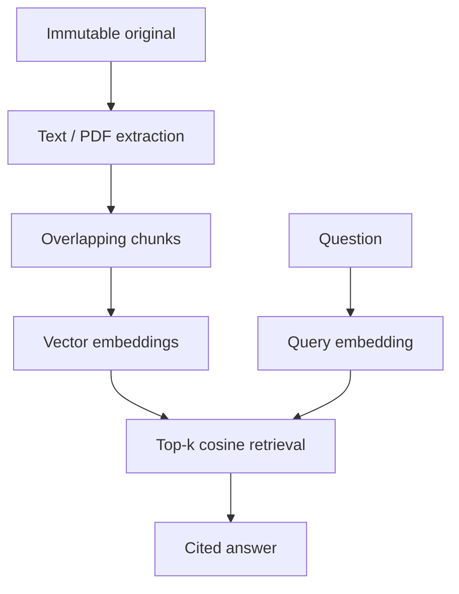

# Library RAG V0

Status: deployed architecture, schema migration v14

Date: 2026-11-18

## Goal

Turn Library originals into a small, inspectable retrieval-augmented learning system without weakening the existing immutable-file guarantees. A returned answer must remain traceable to the exact uploaded resource and its extracted location.

## Data flow



Upload is synchronous in V0: the original is committed first, then indexing runs and returns a visible state. An indexing failure never deletes or rewrites the original.

## Supported inputs

| Input | Extraction | Locator |
|---|---|---|
| UTF-8 text and Markdown | strict UTF-8 decoder | 全文 · 片段 N |
| JSON / XML / XHTML | strict UTF-8 decoder | 全文 · 片段 N |
| Text-based PDF | pdf-parse 2.4.5 | 第 N 页 · 片段 N |
| Scanned PDF | reported as failed | OCR is required |
| Images and other binaries | reported as unsupported | original remains downloadable |

Maximum original size remains 8 MB. Each extracted section is split around natural boundaries with a 900-character target and 120-character overlap. V0 limits one resource to 2,000 chunks and a retrieval scan to 5,000 chunks.

## Embedding providers

The zero-configuration provider is `local-hash-ngram-384-v1`: a deterministic normalized 384-dimensional word/CJK n-gram vector. It is useful for a course-scale, offline demo and keeps tests reproducible. It should not be described as a neural semantic model.

For semantic embeddings, configure an OpenAI-compatible endpoint:

```env
RAG_EMBEDDING_BASE_URL=https://embedding.example/v1
RAG_EMBEDDING_API_KEY=...
RAG_EMBEDDING_MODEL=BAAI/bge-m3
```

Embeddings from different models are never mixed during retrieval; every chunk records its embedding model.

## Answer generation

Without a chat endpoint, the system returns the best retrieved excerpts with numbered citations. With a compatible chat-completions endpoint, it generates a grounded answer and keeps the same citations:

```env
RAG_CHAT_BASE_URL=https://chat.example/v1
RAG_CHAT_API_KEY=...
RAG_CHAT_MODEL=your-model
```

The model prompt treats retrieved documents as untrusted data, ignores instructions inside them, requires evidence-only answers, and requests `[1]`-style citations. If generation fails, the API degrades to retrieved excerpts and reports `generation_error`.

## Schema v14

### `resource_index_states`

One row per indexed resource. Stores status (`pending / ready / failed / unsupported`), extractor, embedding model, chunk count, error message and index timestamps.

### `resource_chunks`

Stores resource FK, stable chunk order, extracted text, human-readable locator, estimated token count, embedding JSON, model and creation time. Deleting a resource cascades to its state and chunks; V0 does not expose resource deletion.

## HTTP API

| Method | Route | Purpose |
|---|---|---|
| GET | `/api/rag/status` | provider and index-state overview |
| POST | `/api/resources/:id/index` | build or rebuild one resource index |
| POST | `/api/rag/search` | return ranked chunks |
| POST | `/api/rag/ask` | return answer plus citations |

Search/ask body:

```json
{
  "query": "全维观测器有什么用途？",
  "limit": 5,
  "resource_ids": ["optional-resource-id"]
}
```

`limit` is constrained to 1–10 and at most 20 resource IDs may be supplied.

## User interface

Library shows the per-resource index status, chunk count and failure reason, offers rebuild controls, and includes a question panel that can search all ready resources or one selected resource. Answers render the mode, embedding model, cited title, locator, score and excerpt. All returned document text is HTML-escaped before rendering.

## Verification

- Unit/integration suite: 34 tests.
- RAG tests cover UTF-8 indexing, cross-resource ranking, citations, unsupported files, automatic HTTP indexing and rebuild.
- Browser regression uses an iPhone-sized viewport, uploads a real text file, asks a question, verifies the cited filename and checks horizontal layout.
